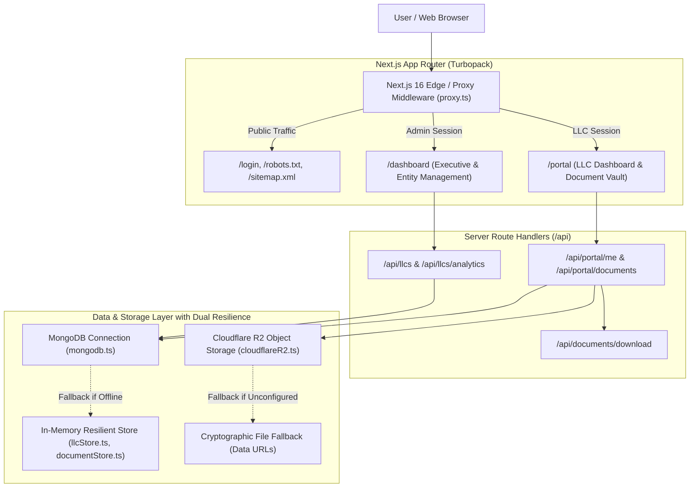

<div align="center">

# 🏛️ Doxera Enterprise Vault
### Corporate Entity Governance & Cryptographic Document Management Platform

[](https://nextjs.org/)
[](https://turbo.build/pack)
[](https://react.dev/)
[](https://www.typescriptlang.org/)
[](https://tailwindcss.com/)
[](https://www.mongodb.com/)
[](https://www.cloudflare.com/products/r2/)

<p align="center">
  A secure, modern fullstack platform designed for corporate governance, enterprise entity lifecycle tracking, and encrypted document vault management. Doxera provides an administrative workspace alongside self-service client portals for registered LLCs.
</p>

</div>

---

## 📑 Table of Contents

- [Executive Overview](#-executive-overview)
- [System Architecture](#-system-architecture)
- [Core Features & Modules](#-core-features--modules)
- [Tech Stack](#-tech-stack)
- [Project Directory Structure](#-project-directory-structure)
- [User Guide (How to Use)](#-user-guide-how-to-use)
  - [Pre-configured Demo Accounts](#pre-configured-demo-accounts)
  - [Admin Workflow](#admin-workflow)
  - [LLC Client Portal Workflow](#llc-client-portal-workflow)
- [Developer Setup & Getting Started](#-developer-setup--getting-started)
  - [Prerequisites](#prerequisites)
  - [Installation](#installation)
  - [Environment Variables](#environment-variables)
  - [Available Scripts](#available-scripts)
- [REST API Reference](#-rest-api-reference)
- [Storage & High Availability Resilience](#-storage--high-availability-resilience)
- [SEO & Metadata Architecture](#-seo--metadata-architecture)
- [Security & Access Control](#-security--access-control)
- [Contributing & License](#-contributing--license)

---

## 🌟 Executive Overview

**Doxera** is built to bridge the gap between corporate management teams and registered business entities (LLCs, corporations, holding companies). It centralizes critical formation documents (Articles of Organization, IRS EIN confirmation letters, Operating Agreements, Annual Franchise Tax permits, Certificates of Good Standing) into an immutable, structured repository with automated validity and expiration tracking.

### Why Doxera?
* **Zero Guesswork for LLCs**: LLC clients see only **authentic, live data** related to their entity—no fabricated graphs or confusing vanity metrics.
* **Proactive Expiration Engine**: Automatic calculation of validity windows (e.g., 10-year durations or fixed end dates) with visual alerts at 90 days before expiration.
* **Dual-Tier Role Security**: Clear separation of privileges between Platform Administrators (`admin`) and Corporate Entities (`llc`).
* **Zero Egress Storage**: Integrated with Cloudflare R2 object storage via the AWS S3 SDK for cost-effective, high-throughput document distribution.

---

## 🏗️ System Architecture



---

## ⚡ Core Features & Modules

### 1. Executive Admin Workspace (`/dashboard`)
* **Live Overview Analytics**: Aggregate entity counts, active standings, pending registrations, and real 7-day registration trajectory timeline.
* **Entity Management (`/dashboard/llc-management`)**:
  * Create new LLC entities with company name, login username, password, and standing status.
  * Search and filter entities by name, reference ID (`LLC-XXXX`), or status.
  * Reset entity credentials and copy reference codes with 1 click.
  * Manage LLC documents: Upload official filings with custom validity periods, duration presets, or explicit end dates.
* **Admin Settings (`/dashboard/settings`)**: Modify administrative profile credentials.

### 2. Client LLC Portal (`/portal`)
* **Real-Data LLC Dashboard (`/portal`)**:
  * Displays **only authentic data** belonging to that LLC.
  * Dynamic metric counters: **Total Documents**, **Active Documents** (valid > 3 months), **Expiring Soon** (< 90 days), and **Expired**.
  * **Recent Documents**: Shows filed records with issue date, expiration date, file format, file size, status badges, and download triggers.
  * **Entity Details**: Legal name, unique reference code, current login, and member since date.
* **Document Vault (`/portal/documents`)**:
  * Comprehensive document explorer with real-time search, multi-field sorting (creation date, end date, title, status), and status filters.
  * Direct downloads for Cloudflare R2 files and generated certified records.
  * Client document upload & modification capabilities with strict file size validation (up to 25MB).
* **Account Settings (`/portal/settings`)**:
  * Strict self-service control: LLC accounts can change their **Company Name**, **Portal Login**, and **Password**, enforcing the principle of least privilege.

### 3. Expiration & Status Computation Engine
* **Flexible Expiration Types**:
  * `duration`: Automatically calculates expiration date from creation date + duration years (e.g., standard 10-year corporate filing).
  * `endDate`: Exact fixed expiration date (e.g., annual licenses, franchise tax certificates).
* **Computed States**:
  * 🟢 **Active**: Valid beyond 90 days (3 months).
  * 🟡 **Expiring Soon / Warning**: Due within 90 days, flagging imminent renewal.
  * 🔴 **Expired**: Past validity date.

### 4. Internationalization (i18n) & Design System
* **Tri-Lingual Support**: English (`en`), Uzbek (`uz`), and Russian (`ru`) with instant switching and persistent `localStorage` cache.
* **Adaptive Theme Engine**: Flawless Dark and Light mode support with CSS variables and Tailwind CSS v4 styling.

---

## 🛠️ Tech Stack

| Layer | Technology | Version | Purpose |
| :--- | :--- | :--- | :--- |
| **Framework** | Next.js | `16.4.5` | App Router, Server Components, API Route Handlers, Turbopack |
| **UI Library** | React & React DOM | `19.3.0` | Modern concurrent rendering, hooks, transitions |
| **Language** | TypeScript | `^5` | Strict static typing, interfaces, and end-to-end type safety |
| **Styling** | Tailwind CSS | `^4` | High-performance CSS engine with Turbopack integration |
| **Database** | MongoDB Native Driver | `^7.8.0` | Document-oriented persistence with automatic connection caching |
| **Cloud Storage**| `@aws-sdk/client-s3` | `^3.1167.0` | S3-compatible integration with Cloudflare R2 Object Storage |
| **Cryptography** | `bcryptjs` | `^3.0.3` | Salted password hashing (cost factor 10) |
| **Icons** | Lucide React | `^1.70.0` | Consistent, accessible iconography |
| **Linter** | ESLint | `^9` | Next.js core Web Vitals & TypeScript ESLint rules |

---

## 📂 Project Directory Structure

```text
doxera/
├── app/                                # Next.js App Router root
│   ├── api/                            # Backend REST Route Handlers
│   │   ├── admin/settings/route.ts     # Admin settings updates
│   │   ├── auth/                       # Login, logout, and session check
│   │   ├── documents/download/route.ts # Cloudflare R2 file streaming download
│   │   ├── llcs/                       # Admin LLC CRUD and aggregated analytics
│   │   └── portal/                     # Authenticated LLC profile and document vault APIs
│   ├── dashboard/                      # Administrator Workspace
│   │   ├── llc-management/page.tsx     # LLC & document administration
│   │   ├── settings/page.tsx           # Admin credentials management
│   │   ├── DashboardOverview.tsx       # Live executive timeline & metrics
│   │   └── layout.tsx                  # Admin authentication gate
│   ├── login/                          # Unified authentication page
│   │   ├── layout.tsx                  # Login-specific SEO & OpenGraph tags
│   │   └── page.tsx                    # Client login component
│   ├── portal/                         # LLC Client Portal
│   │   ├── documents/page.tsx          # Client document vault explorer
│   │   ├── settings/page.tsx           # Self-service company & password settings
│   │   ├── layout.tsx                  # LLC authentication gate & layout
│   │   └── page.tsx                    # Real-data LLC dashboard
│   ├── globals.css                     # Global styles, variables & themes
│   ├── layout.tsx                      # Root HTML layout, SEO metadata, JSON-LD Schema
│   ├── manifest.ts                     # Web App Manifest for PWA & mobile
│   ├── page.tsx                        # Root route dispatcher (redirects to /portal or /dashboard)
│   ├── robots.ts                       # Dynamic robots.txt generation
│   └── sitemap.ts                      # Dynamic sitemap.xml generation
├── components/                         # Shared UI components
├── lib/                                # Core utilities, stores, and models
│   ├── models/
│   │   ├── document.ts                 # Document schema, duration & status calculation
│   │   └── llc.ts                      # LLC entity interface & analytics models
│   ├── i18n/
│   │   ├── LanguageContext.tsx         # Multi-language React Context provider
│   │   └── translations.ts             # English, Uzbek & Russian dictionaries
│   ├── theme/
│   │   └── ThemeContext.tsx            # Dark / Light theme provider
│   ├── adminStore.ts                   # Admin storage & fallback
│   ├── auth.ts                         # Session signing, bcrypt hashing & verification
│   ├── cloudflareR2.ts                 # Cloudflare R2 S3 SDK integration
│   ├── documentStore.ts                # Document repository (Mongo + in-memory fallback)
│   ├── llcStore.ts                     # LLC repository (Mongo + in-memory fallback)
│   └── mongodb.ts                      # MongoDB connection client singleton
├── proxy.ts                            # Next.js request middleware & authentication proxy
├── public/                             # Public static assets & favicons
├── .env.example                        # Documented environment variable template
├── package.json                        # Project dependencies and npm scripts
├── tsconfig.json                       # TypeScript compiler configuration
└── README.md                           # Project documentation
```

---

## 📖 User Guide (How to Use)

### Pre-configured Demo Accounts

Doxera includes ready-to-test accounts out of the box with zero setup required (works seamlessly in both memory and MongoDB modes):

| Role | Username | Password | Destination | Description |
| :--- | :--- | :--- | :--- | :--- |
| **Administrator** | `admin` | `admin123!` | `/dashboard` | Complete control over all LLCs, filings & analytics |
| **LLC Entity #1** | `apexdynamics` | `apexPass123!` | `/portal` | **Apex Dynamics LLC** (Delaware, 4 filed documents) |
| **LLC Entity #2** | `solaria` | `solaria2025!` | `/portal` | **Solaria Ventures LLC** (Wyoming, privacy holding) |
| **LLC Entity #3** | `novahorizon` | `novaSecure789!` | `/portal` | **Nova Horizon Tech LLC** (Texas, pending state filing) |

---

### Admin Workflow

1. **Log In**: Navigate to `/login` and submit the `admin` credentials. You will automatically be routed to `/dashboard`.
2. **Review Executive Metrics**: The main dashboard displays total registered entities and a chronological 7-day registration trajectory.
3. **Manage LLCs**: Click **"LLC Management"** in the sidebar.
   * **Create an LLC**: Click `+ Create LLC`, enter the company name, login username, password, and initial standing (*Active*, *Pending*, *Suspended*).
   * **Upload Documents for an LLC**: Click the document icon on any LLC row. In the documents modal, click `+ New Document`. Select a title, issue date, validity period (e.g., 10-year duration), and attach the PDF or document file.
   * **Edit / Reset Password**: Click the edit or key icon to modify company details or update credentials.

---

### LLC Client Portal Workflow

1. **Log In**: Enter an LLC username (e.g., `apexdynamics`) and password. You will land directly on the LLC Dashboard (`/portal`).
2. **Explore the Dashboard**:
   * View live metrics: Total documents in the vault, active files, expiring files, and expired records.
   * Inspect recent filings and download certified filing records directly.
   * Check your entity reference code (`LLC-XXXX`) and registration standing.
3. **Search & Filter the Document Vault**: Click **"Documents"** in the navigation. Search by keyword or filter by validity status.
4. **Update Credentials**: Click **"Settings"** to update your company name, change your portal username, or set a new password.

---

## 💻 Developer Setup & Getting Started

### Prerequisites

* **Node.js**: v18.18.0 or newer (v20+ recommended)
* **npm**: v9+ (or `pnpm` / `bun`)
* *(Optional)* **MongoDB**: Local or Atlas connection URI. If omitted, Doxera automatically runs with its built-in in-memory repository.
* *(Optional)* **Cloudflare R2**: Account ID and S3 API credentials. If omitted, document uploads safely fall back to local data URLs.

### Installation

```bash
# 1. Clone the repository
git clone https://github.com/your-username/doxera.git
cd doxera

# 2. Install dependencies
npm install

# 3. Create your environment configuration file
cp .env.example .env.local
```

### Environment Variables

Configure your `.env.local` file:

```env
# Application Base URL (Used for SEO and Canonical URLs)
NEXT_PUBLIC_APP_URL=http://localhost:3000

# Authentication & Cryptographic Session Security
SESSION_SECRET=doxera_secure_session_token_key_2025_change_me_in_production

# MongoDB Database (Optional: falls back to in-memory store if offline)
MONGODB_URI=mongodb://127.0.0.1:27017/doxera
MONGODB_DB_NAME=doxera

# Cloudflare R2 Storage (Optional: falls back to local data URLs if omitted)
CLOUDFLARE_R2_ACCOUNT_ID=your_cloudflare_account_id
CLOUDFLARE_R2_ACCESS_KEY_ID=your_r2_access_key_id
CLOUDFLARE_R2_SECRET_ACCESS_KEY=your_r2_secret_access_key
CLOUDFLARE_R2_BUCKET_NAME=doxera-documents
CLOUDFLARE_R2_PUBLIC_URL=
```

### Available Scripts

```bash
# Start development server with Turbopack
npm run dev

# Run strict ESLint verification
npm run lint

# Compile optimized production build
npm run build

# Start production server
npm start
```

---

## 📡 REST API Reference

### Authentication
* `POST /api/auth/login`: Authenticates administrator or LLC credentials, sets a secure HTTP-only cookie, and returns redirect path.
* `POST /api/auth/logout`: Clears the session cookie.
* `GET /api/auth/me`: Verifies the current session token and returns active role information.

### LLC Administration (Admin Only)
* `GET /api/llcs`: Lists all LLCs with support for `?search=`, `?status=`, and pagination.
* `POST /api/llcs`: Creates a new LLC entity and initial credentials.
* `GET /api/llcs/[id]`: Returns entity profile by ID or reference code.
* `PUT /api/llcs/[id]`: Updates entity properties or resets access password.
* `DELETE /api/llcs/[id]`: Permanently removes an entity and associated documents.
* `GET /api/llcs/analytics`: Aggregated executive counts and chronological activity timeline.

### LLC Portal (Client Scoped)
* `GET /api/portal/me`: Fetches authenticated LLC company profile.
* `PUT /api/portal/me`: Restricted endpoint allowing an LLC to update only its `companyName`, `username`, and `password`.
* `GET /api/portal/documents`: Returns all documents belonging to the authenticated LLC, complete with computed expiration statuses.
* `POST /api/portal/documents`: Uploads a new corporate document directly to Cloudflare R2.
* `GET /api/portal/documents/[id]`: Retrieves specific document record.
* `PUT /api/portal/documents/[id]`: Updates document title, validity dates, or file attachment.
* `DELETE /api/portal/documents/[id]`: Removes a document from the vault.

### File Streaming & Downloads
* `GET /api/documents/download?key=...&filename=...`: Streams authentic document binaries directly from Cloudflare R2 storage with appropriate MIME headers and attachment disposition.

---

## 🛡️ Storage & High Availability Resilience

Doxera is engineered with **dual-layer graceful degradation**:

```text
Database Access:
  1. Try MongoDB Connection Pool (mongodb.ts)
  └──> If unreachable, automatically fallback to In-Memory Map repository (llcStore.ts)
       └──> Pre-seeded with authentic sample LLCs for uninterrupted testing & development.

Document File Storage:
  1. Try Cloudflare R2 Object Storage (cloudflareR2.ts)
  └──> If unconfigured, fallback to cryptographic Data URLs / In-Memory Buffers
       └──> Zero external service lock-in during local development or offline environments.
```

---

## 🔍 SEO & Metadata Architecture

Doxera implements an enterprise SEO structure conforming to Google Search Central and OpenGraph standards:

1. **Root Metadata & MetadataBase**: Configured in `app/layout.tsx` with dynamic title templates (`%s | Doxera`), descriptions, and canonical links.
2. **OpenGraph & Twitter Cards**: Complete preview card configurations for social sharing on LinkedIn, X/Twitter, and messaging apps.
3. **Structured Data (JSON-LD)**: Injected `SoftwareApplication` and `Organization` schemas enabling Google Rich Results.
4. **Search Crawler Directives (`app/robots.ts`)**:
   * Public landing and login pages are permitted (`/`, `/login`).
   * Authenticated portals and APIs are protected from indexing (`/dashboard/`, `/portal/`, `/api/`).
5. **XML Sitemap (`app/sitemap.ts`)**: Dynamically generated sitemap with update frequencies and priority weights.
6. **Web App Manifest (`app/manifest.ts`)**: PWA-ready manifest with brand metadata and icon definitions.

---

## 🔒 Security & Access Control

* **Cryptographic Session Tokens**: Uses signed Base64URL session payloads (`username:role:llcId:timestamp:signature`) verified against a server-side secret.
* **HTTP-Only Cookies**: Protected with `SameSite=Lax`, `HttpOnly`, and conditional `Secure` flags in production to mitigate XSS and CSRF vectors.
* **Edge Proxy Middleware (`proxy.ts`)**: Enforces server-side authentication routing before pages render. LLC users cannot access `/dashboard`, and unauthenticated visitors cannot access `/portal`.
* **Sanitized File Handlers**: File uploads enforce MIME validation, 25MB size limits, and filename sanitization to eliminate path traversal vulnerabilities.

---

## 📄 License & Attribution

Distributed under the **MIT License**. Built with precision for enterprise corporate entity management.
